<div align="center">

# DSH Claude Desktop Theme

Bring the Claude Code Desktop look to DeepSeek Harness (DSH) Desktop.

[简体中文](README.md) · English

[Install](#quick-install) · [Screenshots](#screenshots) · [Configuration](#configuration) · [Architecture](ARCHITECTURE.md) · [Installation guide](install.md) · [Report an issue](https://github.com/zkforge/dsh-claude-desktop-theme/issues)

</div>

<p align="center">
  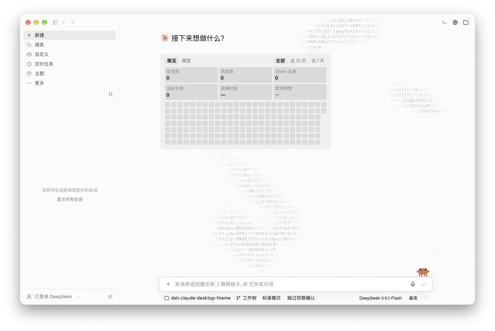
</p>

## Quick install

In DSH, open **Plugins → Add plugin** and enter `dsh-claude-desktop-theme`, or run:

```sh
dsh plugin --profile desktop add dsh-claude-desktop-theme
```

For installation from source and platform-specific CLI paths, see the [installation guide](install.md).

## Using the theme

Under **Settings → Claude Theme → Modules → Home background animation**, choose **Space explorer** for a pixel astronaut that drifts toward the mouse. Click an empty area to send a shooting star across the sky. You can also choose character ripples or turn the animation off.

Enter `/clear` in a conversation to clear its model context while keeping the same session, name, project, model, project instructions and skills. The original log remains available through **View history**. Run the command after the response finishes and the message queue is empty. Fully quit and reopen DSH after installation to load the host command.

## Screenshots

The previews show the macOS light and dark themes. The home page uses the Claude companion and greeting, ripples, and the statistics card.

| Screen | Light | Dark |
| --- | --- | --- |
| New session |  | 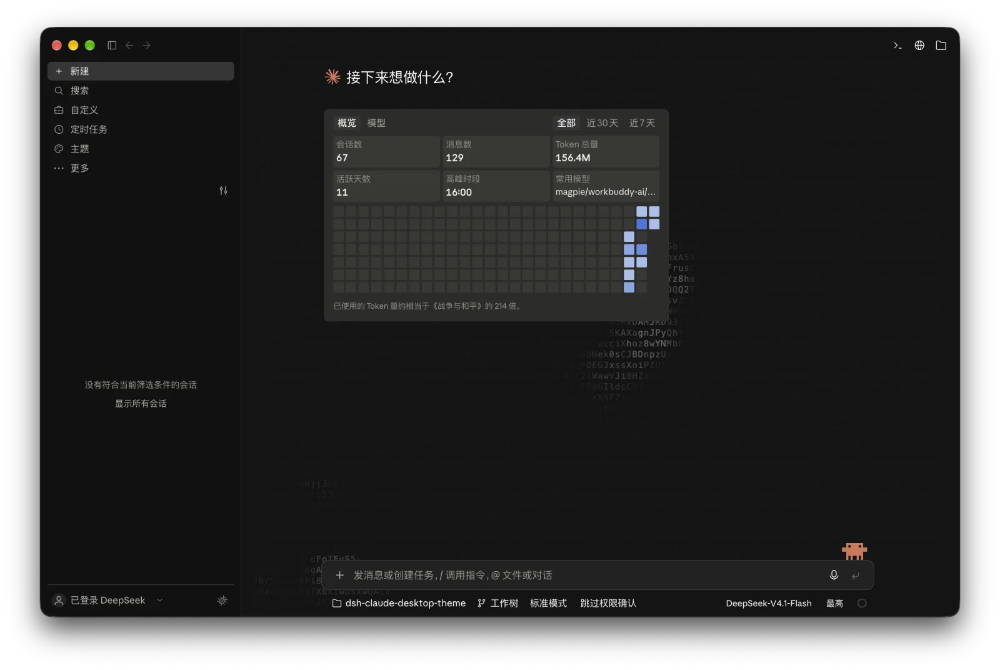 |
| Conversation | 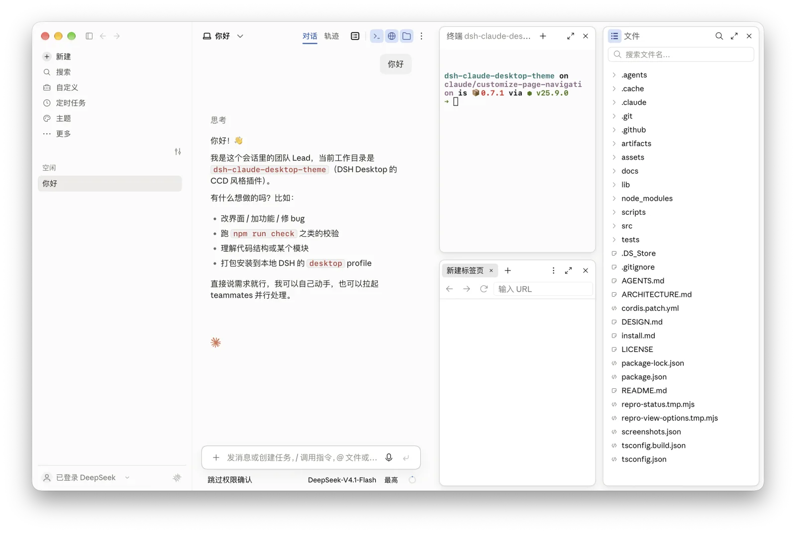 | 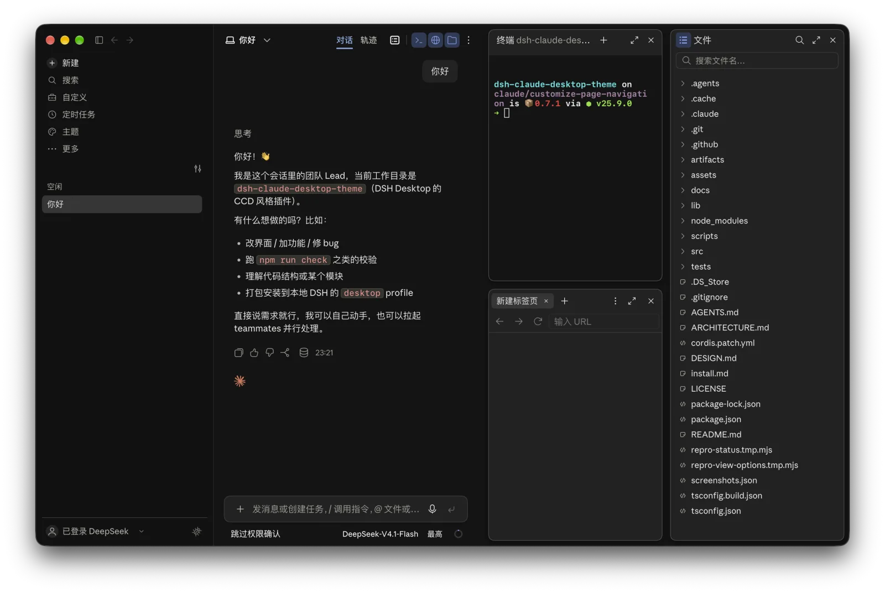 |
| Session information | 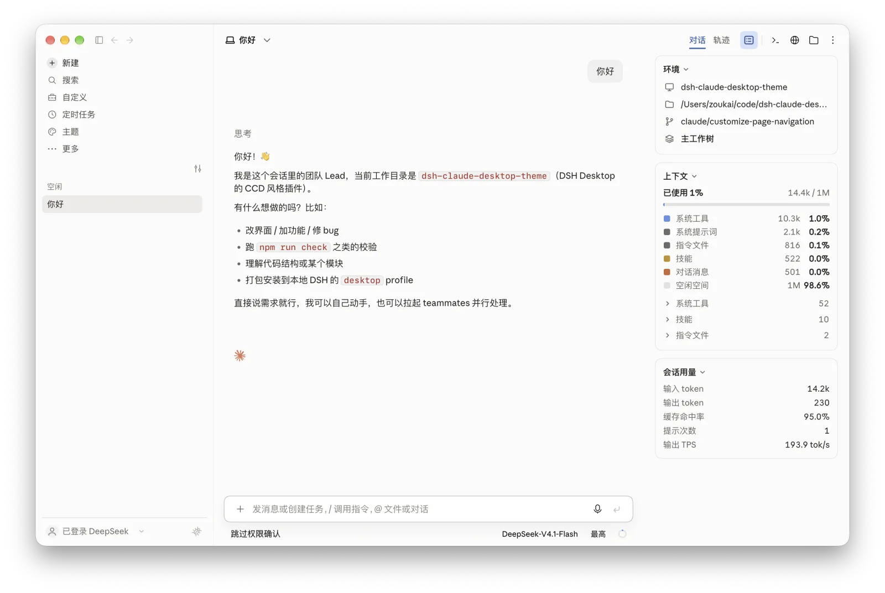 | 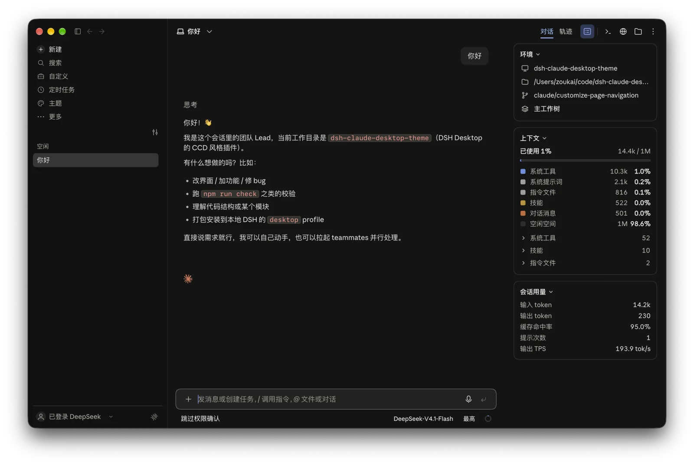 |
| Settings | 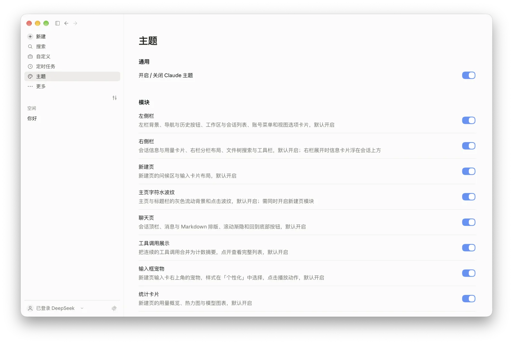 | 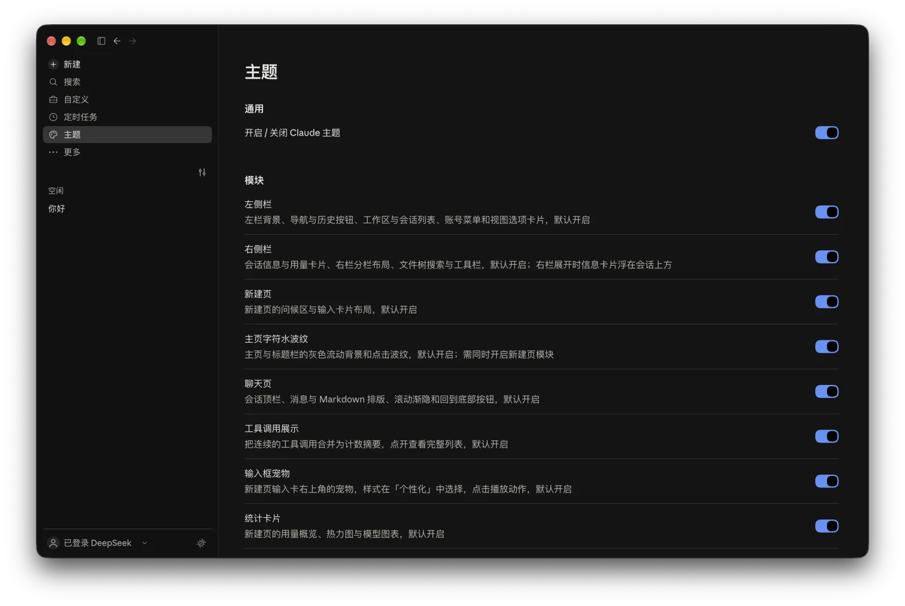 |
| Model picker | 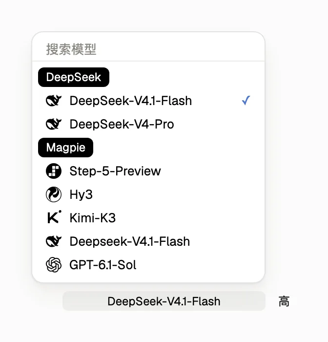 | 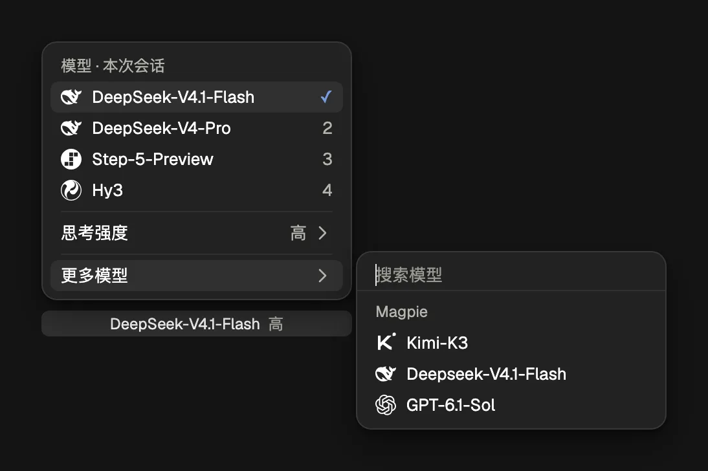 |
| Context breakdown | 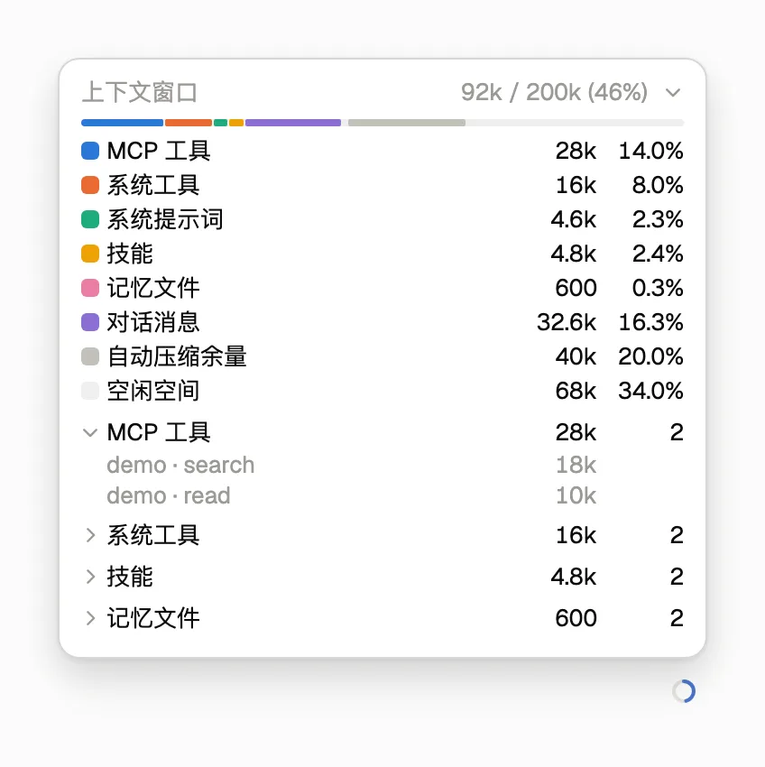 | 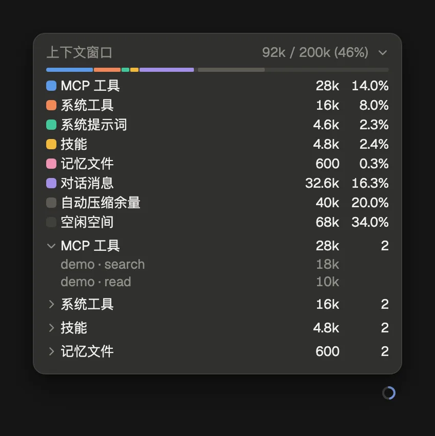 |

Click the whale or Claude companion to play its reaction. Select the companion under **Settings → Claude Theme → Personalization → Pet style**.

<p align="center">
  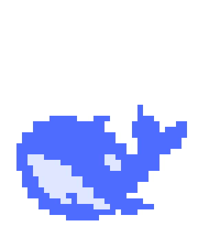
  
  
  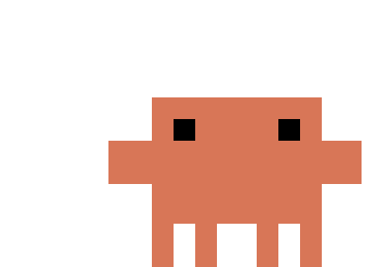
</p>

The highest effort setting adds an animated pixel effect.

<p align="center">
  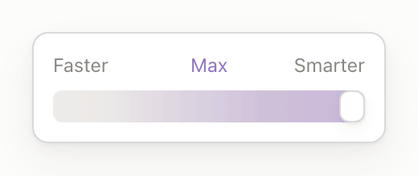
  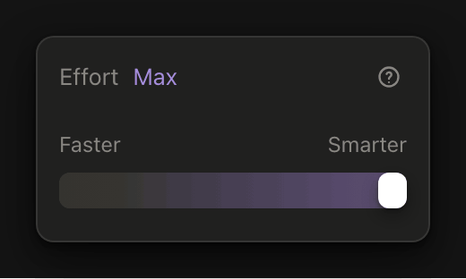
</p>

## Configuration

Open **Theme** in the sidebar or **Settings → Claude Theme**. Changes take effect immediately.

| Group | Options |
| --- | --- |
| Modules | Sidebars, new session, home background animation, conversation, tool calls, composer companion, statistics card, status-bar statistics and context breakdown |
| Appearance | System, light or dark theme, conversation background and sidebar background |
| View | API balance, model icons, separate model and effort controls, conversation process, sidebar brand, header entries and empty groups |
| Personalization | Companion, running status, reply signature and home greeting styles |
| Typefaces | Interface and code fonts. The Chinese interface font can be set in the profile's `cordis.patch.yml`. |

Custom background colours apply in light mode. The default font stacks begin with Anthropic Sans Web, Anthropic Serif Web and SF Mono. The repository includes fonts for local installation under `assets/fonts/`.

## Requirements

The DSH Desktop version range is `>=0.2.1-rc.3 <0.3.0-0`, allowing later `0.2.x` releases and prereleases, including `0.2.2-rc.1`. This range does not imply every version has been tested. The macOS Apple silicon build has been tested with rc5. Windows 10 and later (64-bit) installation is supported, though the newer Windows host build has yet to be verified. Building from source requires Node.js 22.18.0 or newer.

Fully quit and reopen DSH after upgrading to load host interfaces and session projections.

## Feedback and license

Use the feedback button beside the account menu or [open an issue](https://github.com/zkforge/dsh-claude-desktop-theme/issues) with your DSH version, window size and reproduction steps.

[MIT](LICENSE) © 2026 zkforge.
