

# DSH Claude Desktop Theme

为 DeepSeek Harness（DSH）Desktop 换上 Claude Code Desktop 外观

简体中文 · [English](https://github.com/zkforge/dsh-claude-desktop-theme/blob/main/README.en.md)

  
  
  
  

[安装](#快速安装) · [界面预览](#界面预览) · [配置](#配置) · [架构](https://github.com/zkforge/dsh-claude-desktop-theme/blob/main/ARCHITECTURE.md) · [设计规范](https://github.com/zkforge/dsh-claude-desktop-theme/blob/main/DESIGN.md) · [安装指南](https://github.com/zkforge/dsh-claude-desktop-theme/blob/main/install.md) · [问题反馈](https://github.com/zkforge/dsh-claude-desktop-theme/issues)

  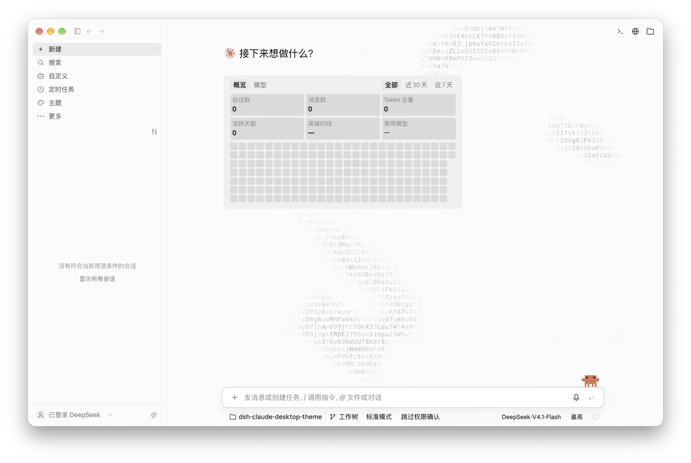

## 快速安装

[npm 包](https://www.npmjs.com/package/dsh-claude-desktop-theme)已发布，两种入口任选其一：

- **插件页**：「插件 → 添加插件」，输入 `dsh-claude-desktop-theme`
- **终端**：`dsh plugin --profile desktop add dsh-claude-desktop-theme`

源码安装见[安装指南](https://github.com/zkforge/dsh-claude-desktop-theme/blob/main/install.md)。

## 使用

在「设置 → Claude 主题 → 模块 → 主页背景动效」选择「宠物畅游」，像素宇航员会缓缓跟随鼠标，点击空白处会划过流星。也可切回默认的字符水波纹或关闭背景动效。

会话中输入 `/clear` 可以清空当前对话上下文，继续使用同一个会话：会话 ID、名称、项目、模型、项目指令与技能目录保留，旧消息和工具结果不再发送给模型。原始日志仍在，「查看历史记录」可展开旧内容，查看不会恢复模型上下文。命令不调用模型、不生成摘要；请在回复结束且没有排队消息时执行。安装后需完整退出并重新打开 DSH，加载宿主命令。

## 界面预览

以下展示 macOS 浅色与深色主题的完整窗口。首页使用 Claude 像素宠物与问候样式，开启水波纹和统计卡片；会话页展示终端、浏览器与文件栏，信息卡片单独展示环境、上下文分解与会话用量。两种宠物的点击回应与 Effort 拉到底的动效见下一节。

| 界面 | 浅色 | 深色 |
| --- | --- | --- |
| 新会话页 |  | 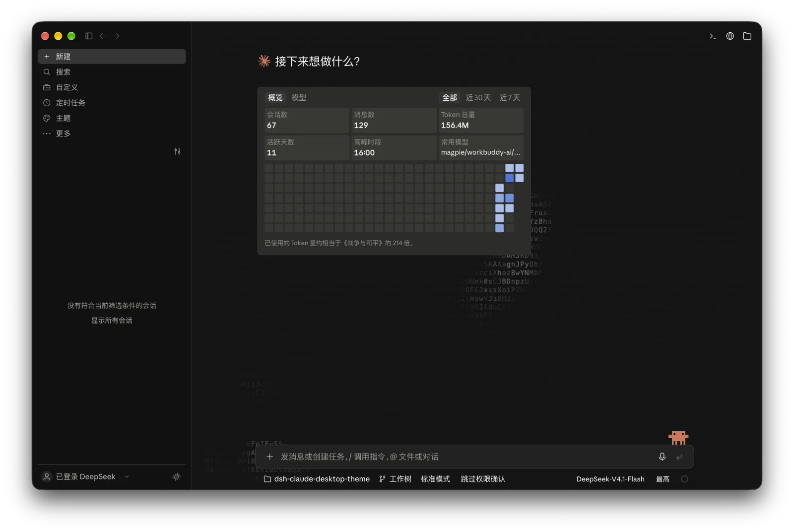 |
| 会话页 | 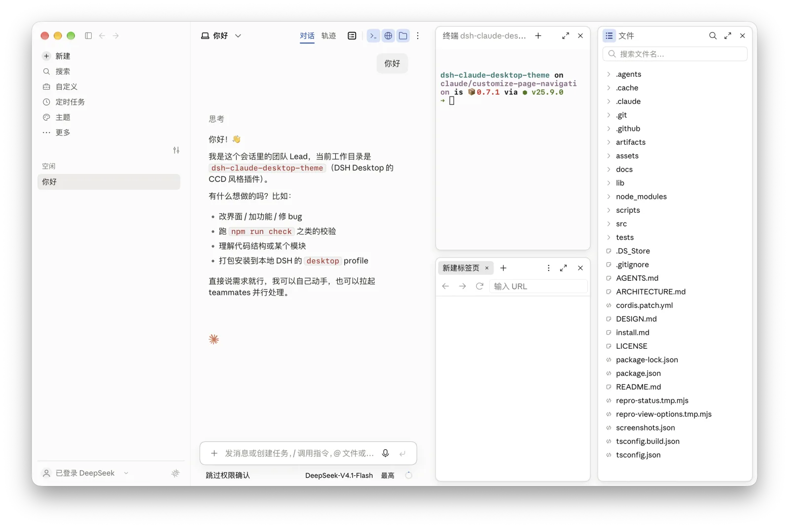 | 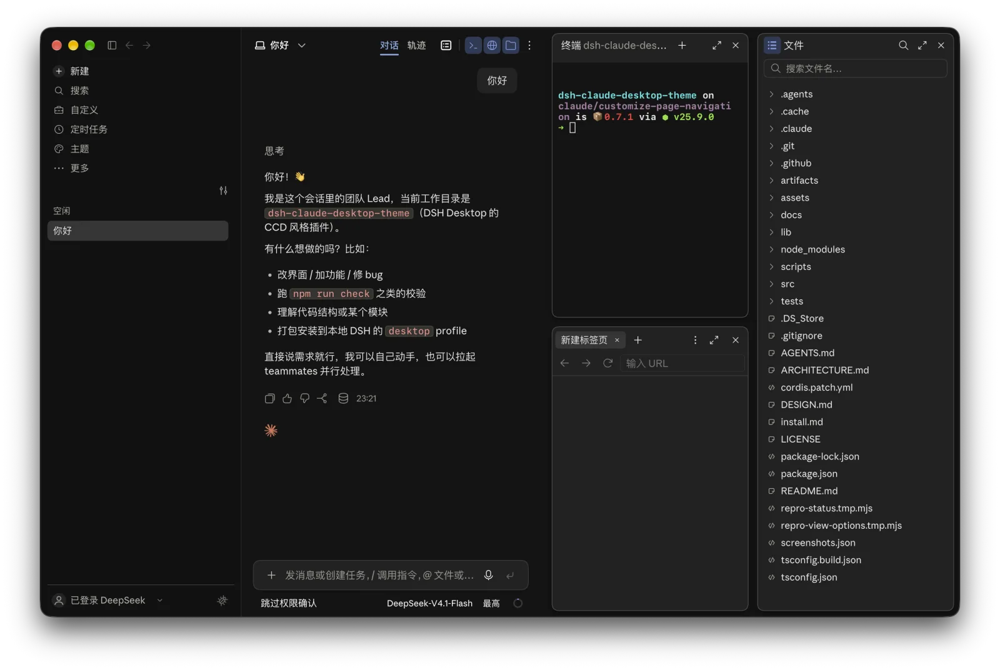 |
| 右侧信息卡片 | 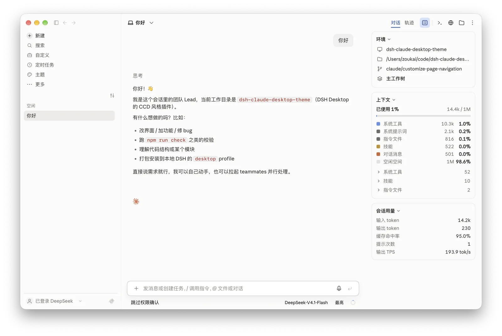 | 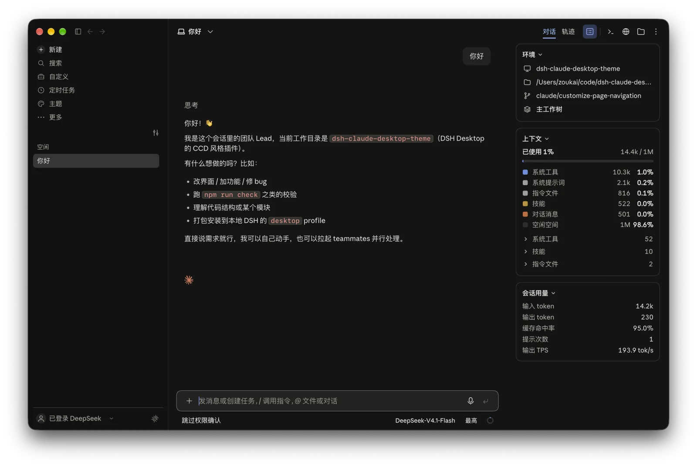 |
| 插件设置 | 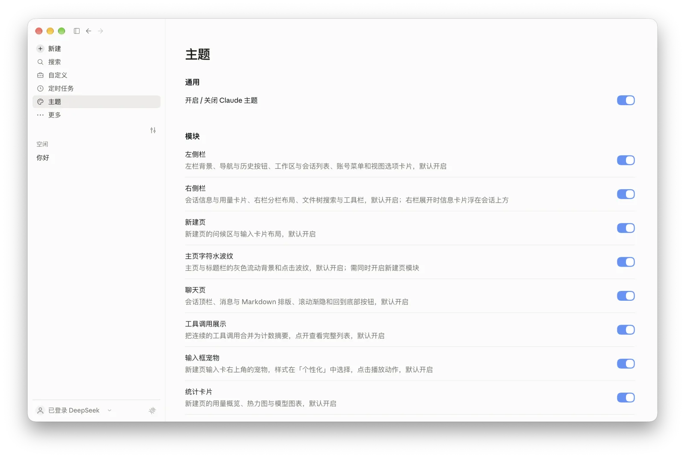 | 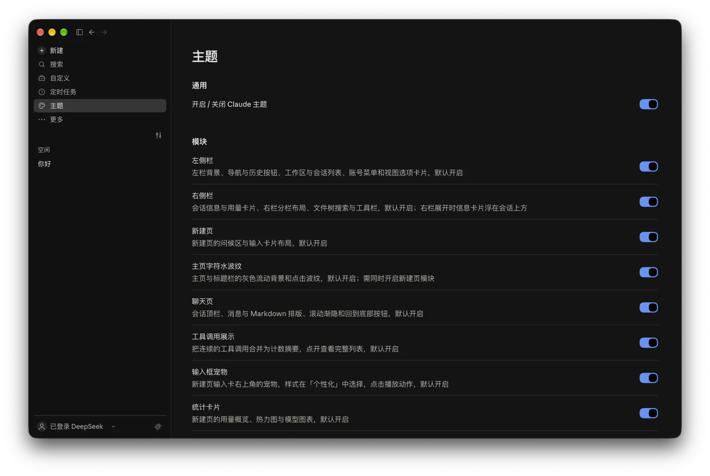 |

### 组件特写

| 组件 | 浅色 | 深色 |
| --- | --- | --- |
| 模型选择器 | 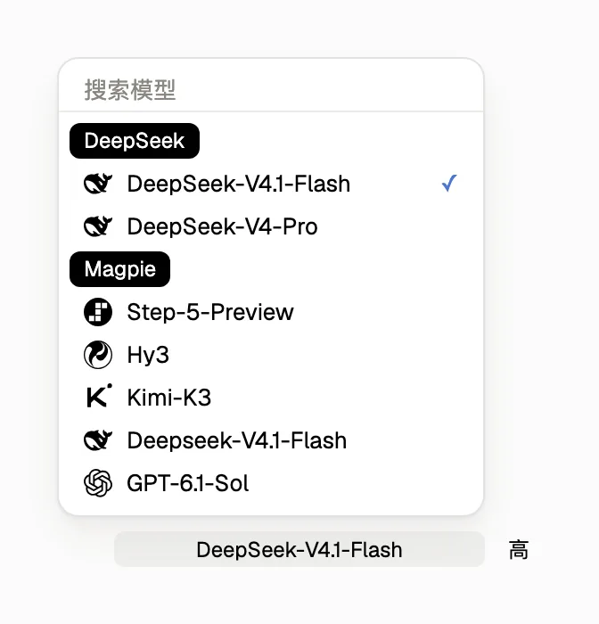 | 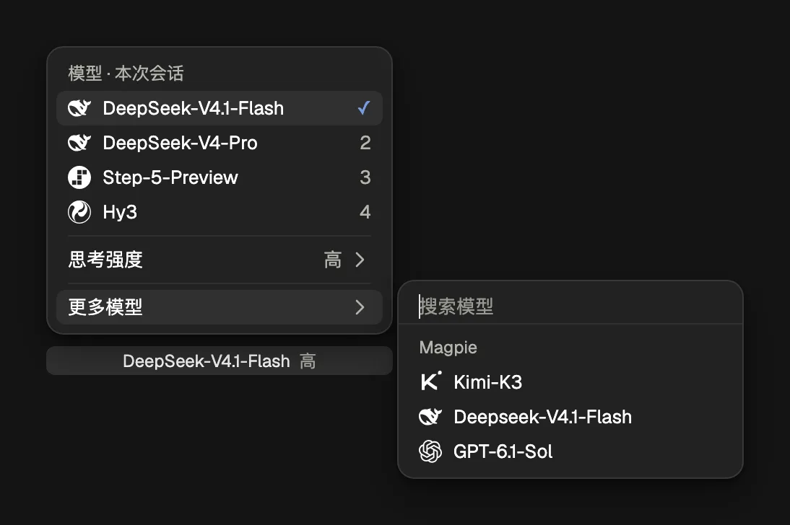 |
| DeepSeek 余额 | 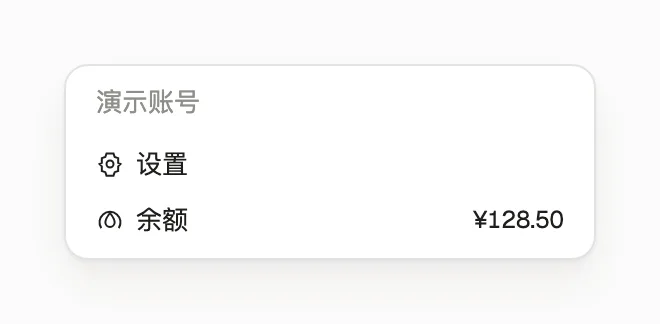 | 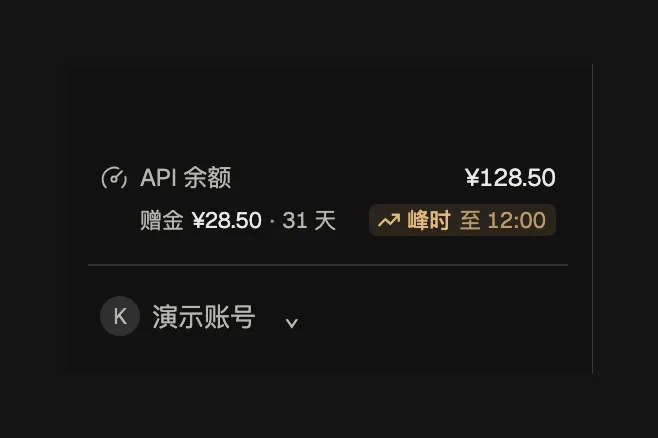 |
| 上下文圆环与分解面板 | 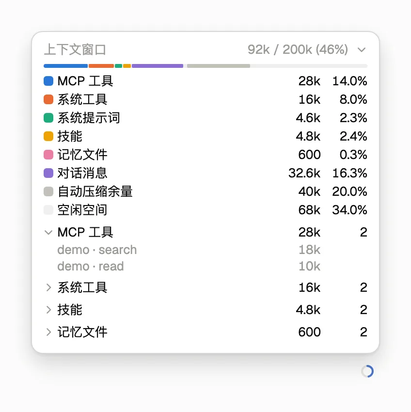 | 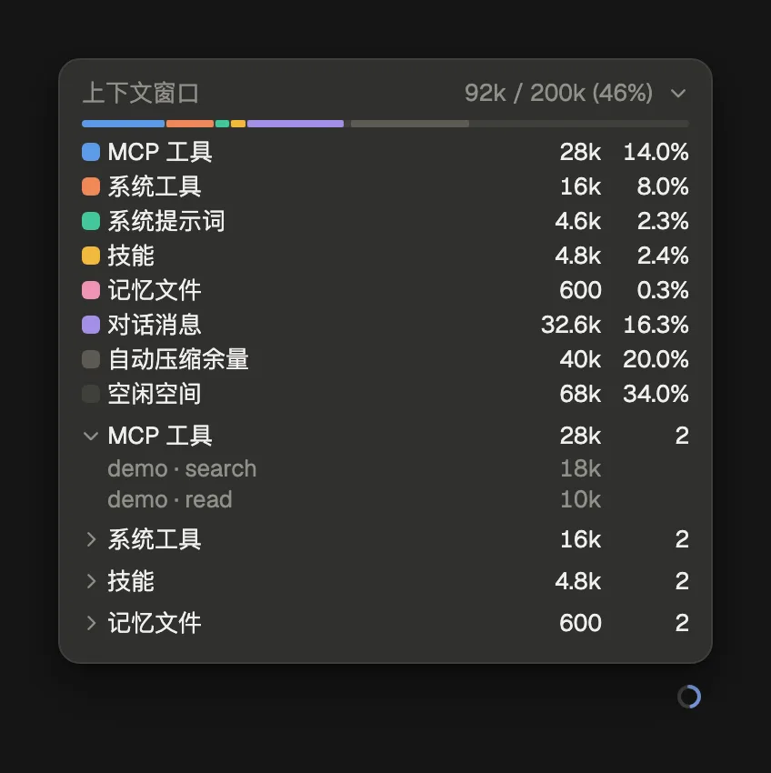 |
| 会话右侧信息卡片 | 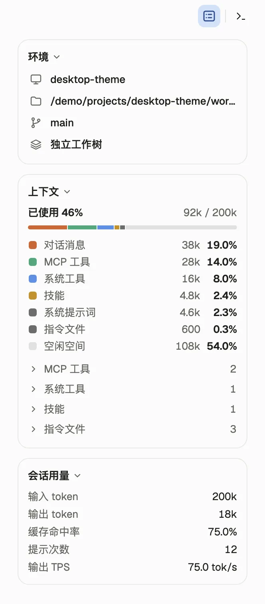 | 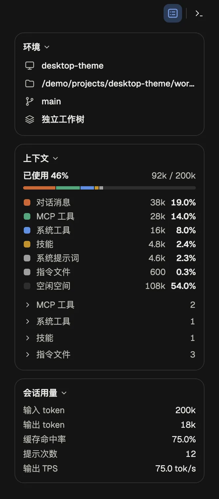 |

以下为真实组件的局部截图，使用演示数据。模型选择器展示供应商分组、模型图标与当前选中项；可选模型和 Effort 档位以 DSH 实际提供的目录为准。余额特写使用演示账号与金额，常显于左下角账号上方，右侧突出总余额，左下显示当前峰谷时段，点击可刷新。上下文面板展示分类占比与展开的 MCP 工具明细，右下角保留用量圆环入口。会话信息卡片特写展示环境图标行、按占用排序的上下文分类与会话用量。

## 细节动效

<table>
<tr>
<td width="25%" align="center">
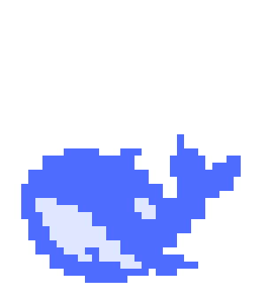 
<b>喷一口水</b> 
身体轻晃、闭眼，从头顶喷出水柱，水滴向两侧散开落下
</td>
<td width="25%" align="center">
 
<b>轻弹眨眼</b> 
蓄力、向上轻跳、落地回弹并眨眼
</td>
<td width="25%" align="center">
 
<b>摆尾回应</b> 
身体左右轻晃，尾巴与胸鳍摆动并眨眼
</td>
<td width="25%" align="center">
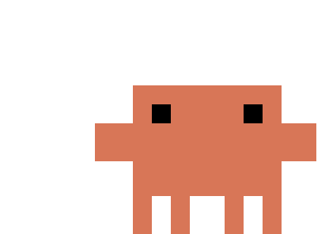 
<b>Claude 像素宠物</b> 
取出笔记本电脑、敲键盘，再恢复站姿
</td>
</tr>
</table>

在「设置 → Claude 主题 → 个性化 → 宠物样式」中切换小鲸鱼或 Claude 像素宠物，点击宠物即可播放动作。

<table>
<tr>
<td width="50%" align="center">
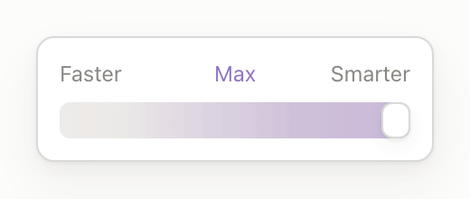 
<b>Effort 拉到底 · 浅色</b>
</td>
<td width="50%" align="center">
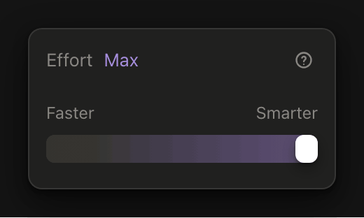 
<b>Effort 拉到底 · 深色</b>
</td>
</tr>
</table>

## 配置

打开侧栏「主题」或「设置 → Claude 主题」，改动即时生效：

| 分组 | 可调项 |
| --- | --- |
| 模块 | 左侧栏、右侧栏（独立启停）、新建页、主页背景动效（字符水波纹、宠物畅游或关闭，默认水波纹）、聊天页、工具调用展示、输入框宠物、统计卡片（默认开启）、状态栏统计读数（默认关闭）、上下文分解面板 |
| 外观 | 主题（浅色 / 深色 / 跟随系统）、会话背景色、侧栏背景色 |
| 视图 | 显示 API 余额、显示模型图标、分开显示模型与思考强度、过程默认展开（默认开启）；DeepSeek Harness 品牌条目、顶栏子代理入口、顶栏团队入口、顶栏后台任务入口、显示空分组（默认均关闭） |
| 个性化 | 宠物样式、输出中状态、回复签名、首页问候（默认 Claude 样式，宠物、签名与问候可分别关闭） |
| 字体 | 界面字体、代码与等宽字体；界面中文字体在设置页不列，需写进 profile 的 `cordis.patch.yml` |

> [!NOTE]
> 自定义背景色只作用于浅色模式，深色模式使用内置深色调色板。默认界面西文、中文与代码字体分别为 Anthropic Sans Web、Anthropic Serif Web 与 SF Mono，未安装时沿字体栈回退；仓库的 `assets/fonts/` 提供本机安装用字体与 OFL 许可，字体不包含在 npm 包中。

## 环境要求

支持 DSH Desktop `0.2.1-rc.3` 与 `0.2.1-rc.5`，macOS（Apple 芯片）已使用 rc5 实机核验，开发 SDK 保持 rc3 基线。Windows 10 及以上（64 位）的安装入口保留，Windows rc5 实机尚未验证。源码构建另需 Node.js ≥ 22.18.0。升级后请完整退出并重新打开 DSH，以加载宿主接口与会话投影。

## 反馈与许可

点击侧栏左下角账号旁的反馈按钮，填写描述后会打开预填好环境信息的 GitHub Issue；也可以直接通过 [Issue](https://github.com/zkforge/dsh-claude-desktop-theme/issues) 反馈问题，附上 DSH 版本、窗口尺寸和复现步骤。

[MIT](./LICENSE) © 2026 zkforge。
