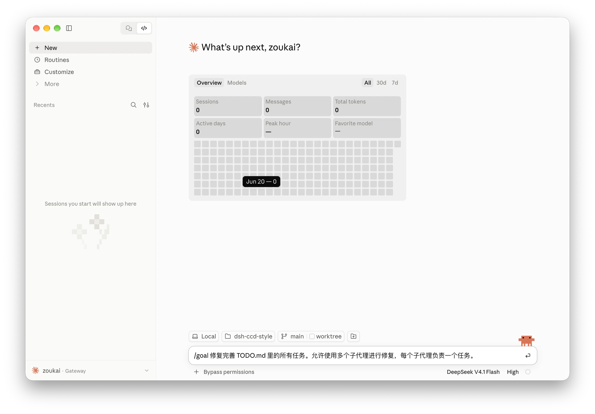
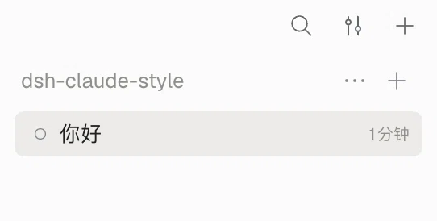
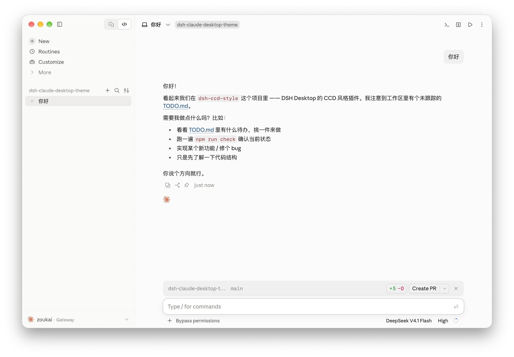
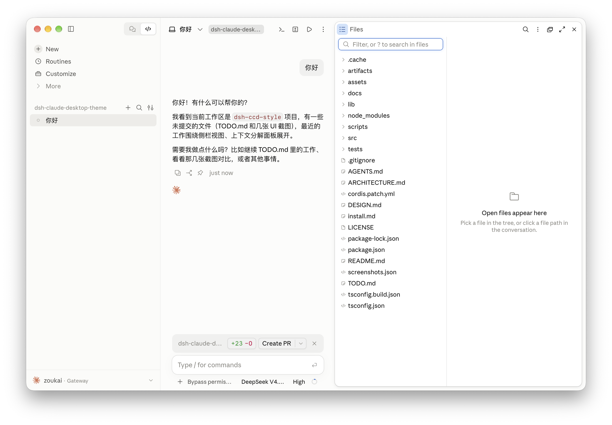
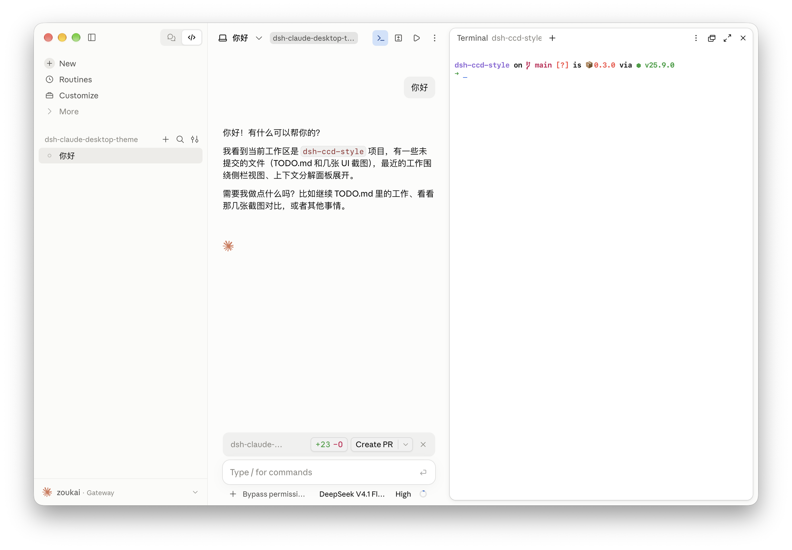
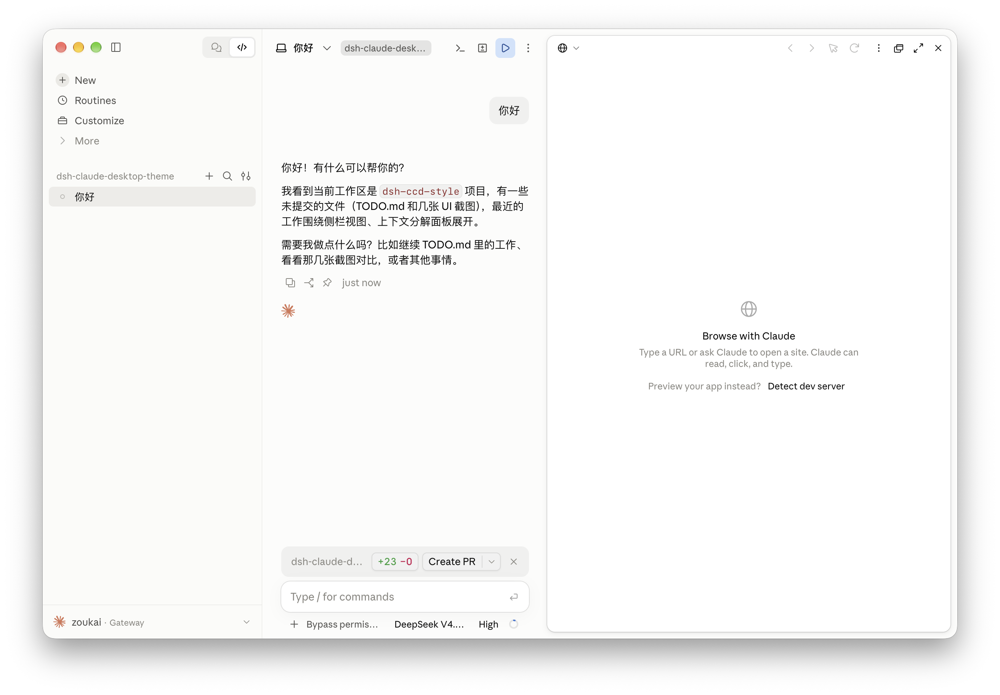
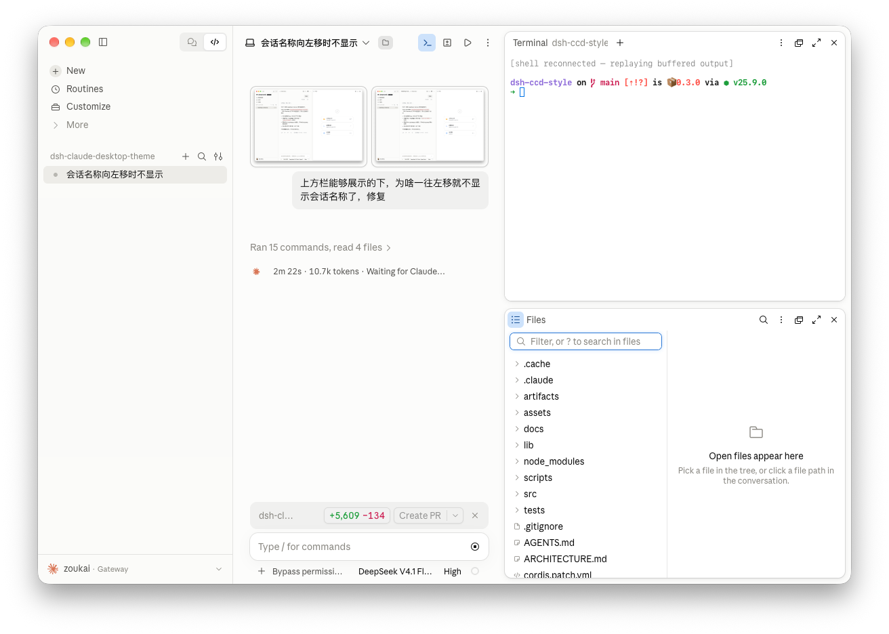

# 任务

- 完成后请打勾 ：✅

1. ✅ 把「对话 / 轨迹」切换按钮从对话区顶部移到侧栏，位置按 Claude 侧栏里的摆放方式（第二张图的版式）。

   现状：切换按钮在对话区顶部。

   

   涉及文件：`src/client/compat/view-switch.ts`、`src/client/features/conversation/conversation.css`、`src/client/features/sidebar/`。

2. ✅ 侧栏样式与 Claude 对齐。DSH 现状是一行「搜索 / 筛选 / 添加工作区」，另一行是首个工作区；Claude 的形态是：没有会话时显示「最近会话」四个字，右侧是搜索和筛选两个按钮；有会话时按第四张图，第一个会话的右方展示新建会话的加号，以及搜索和筛选。

   | 现状：无会话 | 现状：一行搜索、筛选、添加工作区，一行首个工作区 | 有会话时的参考 |
   | --- | --- | --- |
   |  |  |  |

   涉及文件：`src/client/features/sidebar/sidebar.css`、`src/client/features/new-session/`、`src/client/compat/empty-groups.ts`、`src/client/compat/workspace-menu.ts`。

3. ✅ 侧栏三个入口里，点击「新建会话」后的选中底色不能保持，鼠标移开就消失；改成和另外两个入口一样，选中期间底色一直保留。

   涉及文件：`src/client/compat/sidebar-navigation.ts`、`src/client/features/sidebar/navigation.css`、`src/client/features/sidebar/sidebar.css`。

4. ✅ 把 DSH 的右侧栏改成浮动卡片的观感（三张预览图：Files、终端、浏览器）。面板脱离窗口边缘，自成一张带圆角的卡片，有自己的底色和轻微阴影，和侧栏的卡片风格统一。同时 Files 也要像 claude 一样的目录观感包括收起按钮，每个文件前的样式也是。

   | Files | 终端 | 浏览器 |
   | --- | --- | --- |
   |  |  |  |

   涉及文件：`src/client/features/shell/shell.css`（`_6Qf49G_rightbarCol`）、`src/client/features/context-panel/`。

5. ✅ 右侧栏从「标签页」改成「分栏」：不再是一条共用的页签栏，而是每个视图一格、各自一条标题行与关闭，按 1/2/3/4 块铺在面板里（上下左右都能分，像 Claude），格与格之间是可拖的分隔线。

   

   宿主的限制：右侧栏用的 DockKit 标签式渲染器只接受「一格」或「左右两格」，竖分或第三格会让宿主抛错，分栏按钮也写死两格上限；所以四块只能走宿主自己的**浮层面板**（`float`，`position: fixed` 的卡片，自带标题行、关闭、停靠，内容由宿主渲染）。

   已按 2026-10-12 的 mp4 补齐：两列独立上下拖动、关闭同列补位、移除顶部空行、按视频复刻标题栏按钮与图标、面板放大／还原、Files 内部预览与树宽拖动、会话隔离及最后一块关闭自动收起。

   涉及文件：`src/client/compat/right-panes.ts`、`src/client/compat/host-dom.ts`、`src/client/contracts/ports.ts`（`SidebarRightPort` 补 `float`）、`src/client/features/shell/right-panel.css`。
